  <a href="./README.md">🇪🇸 Español</a> · <b>🇬🇧 English</b>

  

  

  
  
  
  
  

## 🌆 About me

- 💼 Developer at **[AHORA](https://www.ahora.es/)**.
- 🎓 Graduated in **Multiplatform Application Development** (DAM).
- 📱 I enjoy **Android** development with Kotlin + Jetpack Compose, and backend work with **Spring Boot**.
- 🛠️ In my free time I build tools for everyday use, like a voice assistant or AirPods support on Linux.
- 🏕️ Web developer for my Scout group, **Impeesa 243** (Burjassot).

## ⚒️ Tech stack

  

  
  
  
  
  

## 🚀 Featured projects

| | |
|---|---|
| 🎧 **[AirPods on Linux](https://github.com/canoojson/airpodsPopUpOnArchLinux)** | AirPods battery (even with the case closed) and an iOS-style popup when you open the case. BLE + BlueZ + Noctalia. |
| 💸 **[Finances](https://github.com/canoojson/finanzas)** | Self-hosted personal finance PWA on Cloudflare Workers + D1. |
| 🌐 **[Portfolio](https://github.com/canoojson/canoojson.github.io)** | My personal site, built with React + Vite: [canoojson.dev](https://canoojson.dev). |
| 🏕️ **[Scouts website](https://github.com/canoojson/Web-Scouts)** | Website for the Impeesa 243 Scout group in Burjassot. |

## 🎧 What I'm listening to

  

  Always on repeat: 
  
  
  
  

## 🎮 What I play

  
  
  

  
  
  
  
  
  

  🚚 I drive Euro Truck Simulator 2 with a G920 wheel and a phone button box I built myself. 
  

## 🌌 Worlds I'm a fan of

  
  
  
  
  
  

## 🐍 My contributions

  

  ✦ Thanks for stopping by. Want to talk code, music, or whether Gandalf could beat Yoda? Reach out. ✦

